# Tubify

  

A minimal YouTube client for Android in two flavors. No ads, no Shorts, no suggestions, no comments. Just YouTube.

## Screenshots

Tubify v0.1.57 on an Android emulator.

Tubify (Full):

  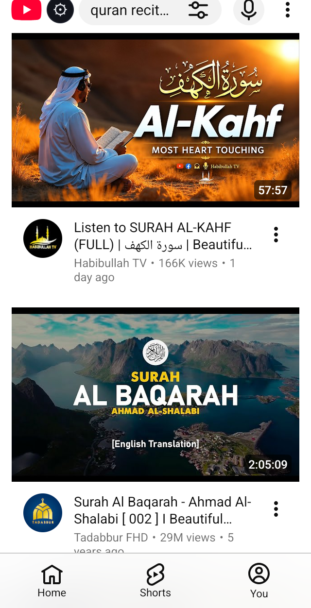
  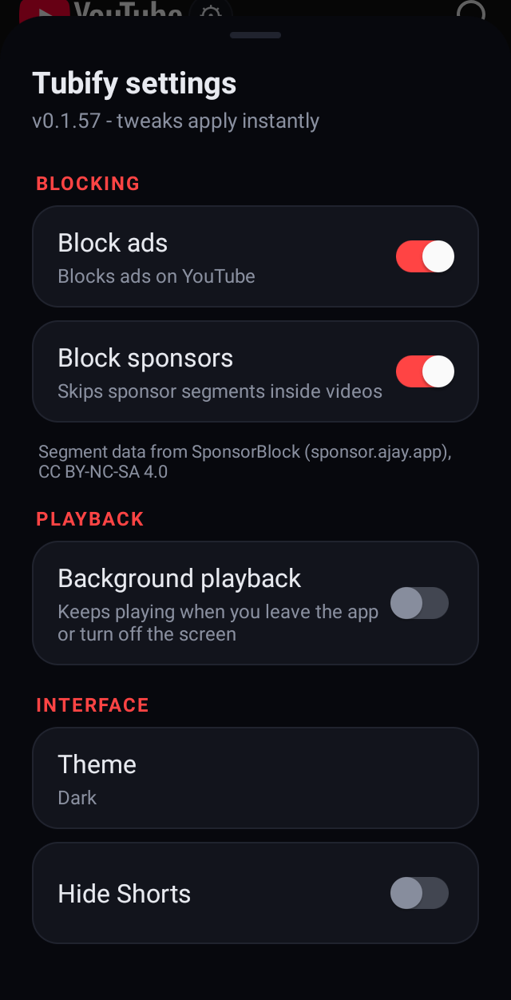
  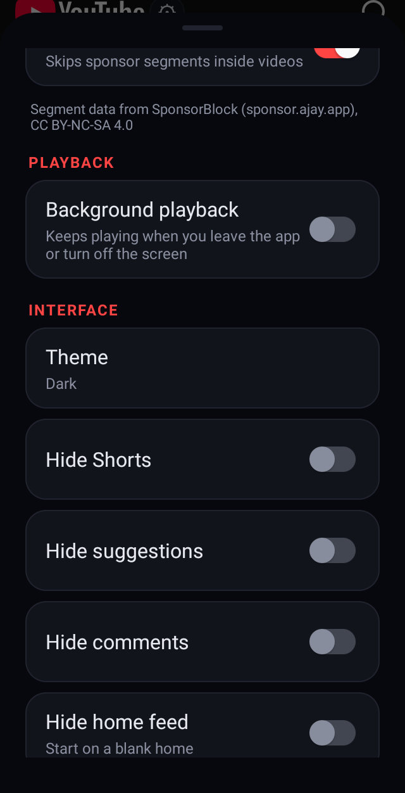
  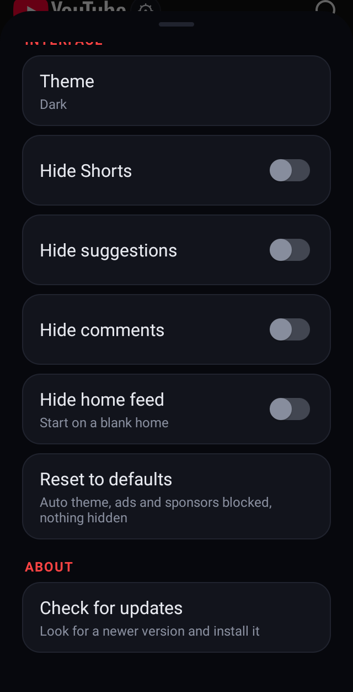
  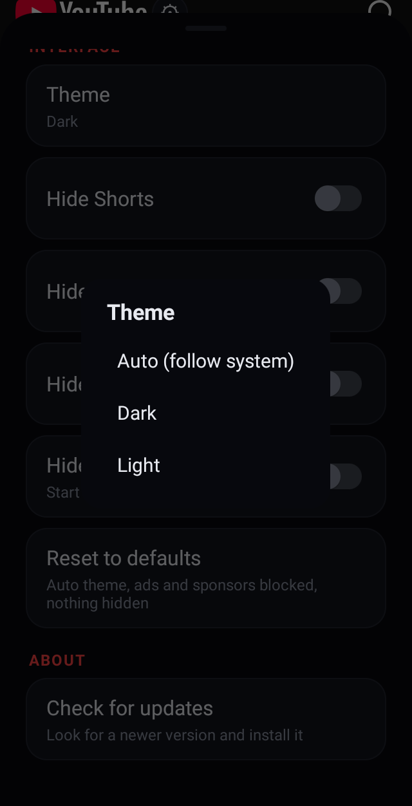
  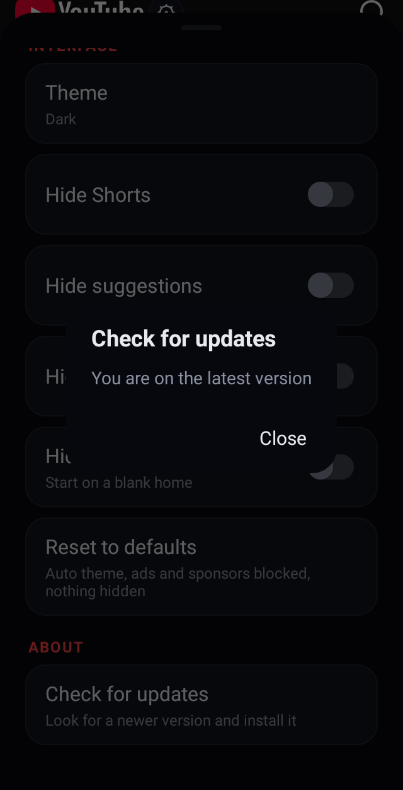
  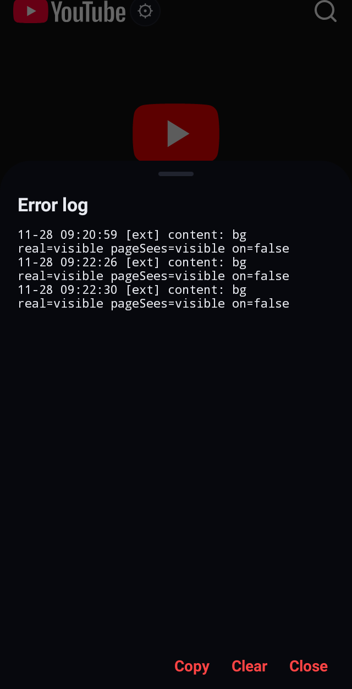

Tubify Lite:

  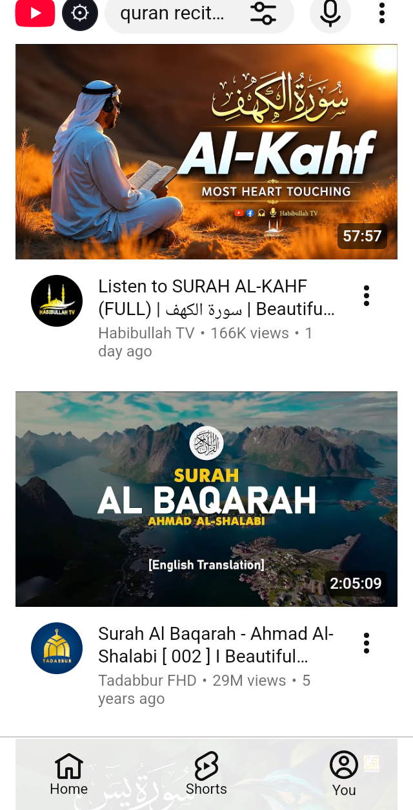
  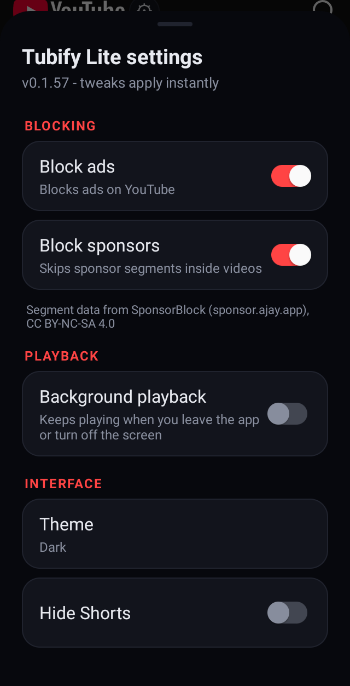
  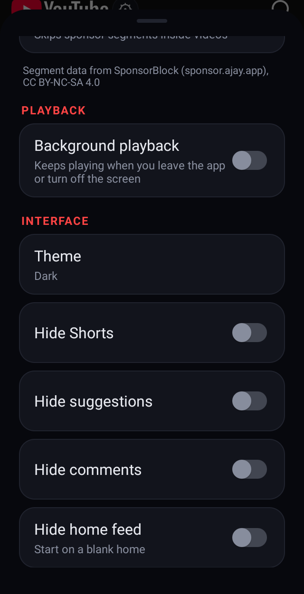
  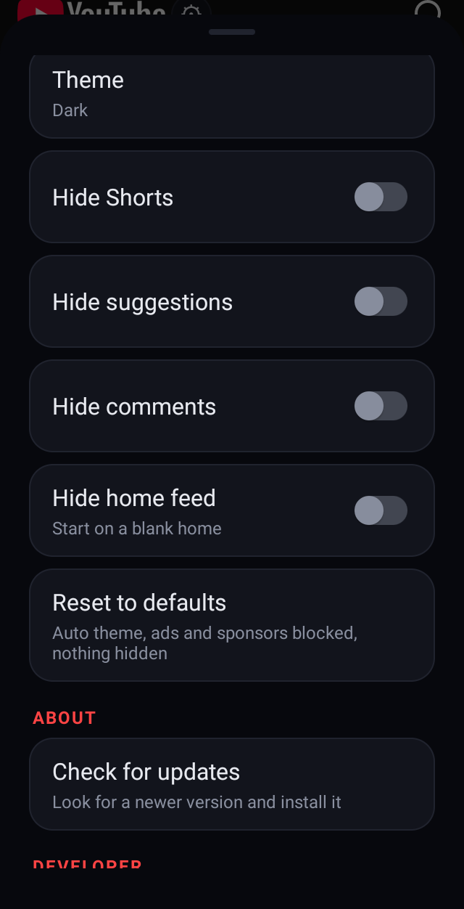
  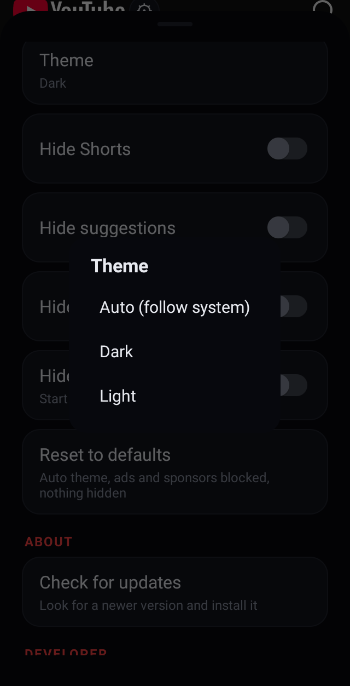
  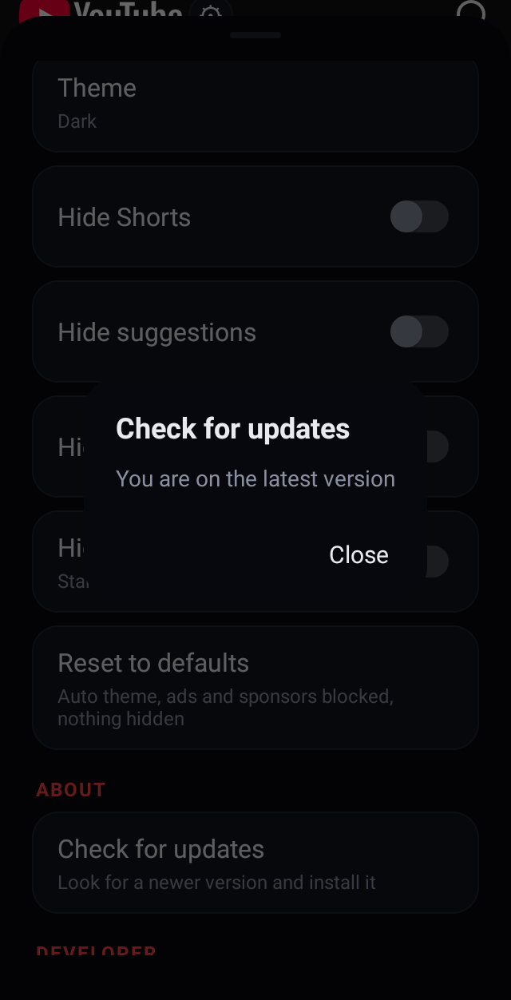
  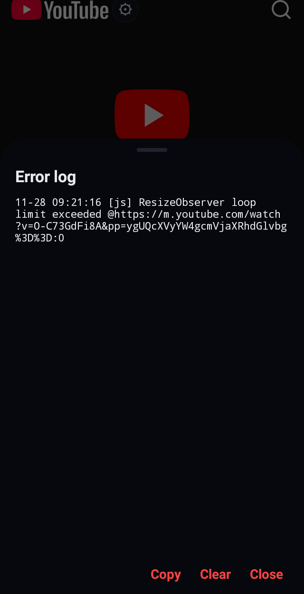

## Two variants

| | **Tubify** (Full) | **Tubify Lite** |
|---|---|---|
| Engine | GeckoView (real Firefox engine) | Android WebView |
| Ad blocking | uBlock Origin, installed from addons.mozilla.org on first run | Built-in request blocking (weaker, no filter lists) |
| Size | ~86-94 MB per ABI (~238 MB universal) | ~50 KB |
| Google sign-in | Works | Not available |
| Good for | Daily use | The lightest possible YouTube |

## Features

- Ad blocking (uBlock Origin in Full, built-in blocking in Lite)
- Gear button in the YouTube header with instant toggles:
  - Ad blocking
  - Hide Shorts (including the bottom-nav Shorts tab)
  - Hide suggestions / related feed
  - Hide comments
- In-app diagnostics in the settings sheet: tweaks extension state, app bridge, uBlock Origin state and the last error
- Dark, app-like (PWA) feel
- Themed launcher icon (adaptive + monochrome)
- Signed with the permanent Tubify release key, so updates install over old versions

## Install

Requires Android 10 (API 29) or newer.

1. Open [Releases](https://github.com/ctmhod/Tubify/releases) and pick the latest version.
2. Download the right APK (universal is listed first on purpose):
   - **Tubify-vX.Y.Z-0-universal.apk** - works on every device; large (~237 MB, GeckoView inside)
   - **Tubify-vX.Y.Z-arm64-v8a.apk** - most phones from the last years (~89 MB; choose this if unsure and short on space)
   - **Tubify-vX.Y.Z-armeabi-v7a.apk** - older 32-bit phones
   - **Tubify-vX.Y.Z-x86_64.apk** - emulators and x86 devices
   - **Tubify-Lite-vX.Y.Z.apk** - the tiny WebView build (~55 KB), works everywhere
3. Open the APK and allow "install unknown apps" when Android asks.
4. Full version: on first run, uBlock Origin installs itself from addons.mozilla.org and the page reloads once. Tap the gear in the YouTube header to set your tweaks.

### "App not installed"?

- **Uninstall the old Tubify first.** Early test builds may carry a different signing key, and Android refuses cross-key updates. Your in-app toggles reset; nothing else is lost.
- **Free space.** The universal APK needs roughly 1 GB free to install (Galaxy Tab A6 owners: the arm64-v8a build needs much less).
- **Don't downgrade.** Uninstall first if you must go back to an older version.

## Notes

- Tubify is a web wrapper around [m.youtube.com](https://m.youtube.com) with extensions. Using it is subject to the [YouTube Terms of Service](https://www.youtube.com/t/terms).
- Tubify is not affiliated with, sponsored or endorsed by YouTube or Google. "YouTube" is a trademark of Google LLC.
- Tubify Lite depends on the system WebView and needs a WebView provider (Chrome) installed; its Google sign-in and ad blocking are less reliable by design.

## Build

Every release is smoke-tested on an Android 10 (API 29) emulator in CI before publishing: install, launch, crash check, screenshot.

Releases are built by GitHub Actions (`.github/workflows/release.yml`) straight from this source tree and signed with the Tubify release key stored in CI secrets. Old-release icon refreshes use `.github/workflows/reicon.yml`, which swaps icon pixels inside the published APKs and re-signs them with the same key, without deleting or recreating any release.
